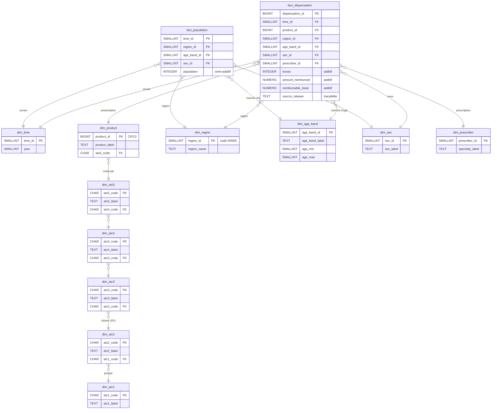

# Consommation d'antibiotiques en ville en France — Capstone BDSM

**Cours :** Big Data Storage & Management (M2 HSIM, IAE Lyon) · Dr. Genoveva Vargas-Solar, Prof. Chirine Ghedira-Guégan
**Objectif de développement durable :** ODD 3 — Bonne santé et bien-être (lutte contre la résistance aux antibiotiques)

## Question de recherche

> Comment la consommation d'antibiotiques en ville varie-t-elle selon les régions, l'âge, le sexe et les prescripteurs, et comment évolue-t-elle d'une année sur l'autre ?

**Utilisateurs visés :** agences régionales de santé (ARS), Assurance Maladie, Santé publique France.

## Données

| Fournisseur | Jeu de données | Années utilisées | Rôle dans l'entrepôt |
|---|---|---|---|
| Assurance Maladie | [Open Medic](https://www.data.gouv.fr/datasets/open-medic-base-complete-sur-les-depenses-de-medicaments-interregimes) : médicaments délivrés en pharmacie de ville (colonnes `ATC1`…`ATC5`, `CIP13`, `age`, `sexe`, `BEN_REG`, `PSP_SPE`, `BOITES`, `REM`, `BSE`) | Bases annuelles 2024 et 2025 (deux versions) | `fact_dispensation` |
| INSEE | [Estimations de population](https://www.insee.fr/fr/statistiques/8721456) au 1er janvier, par région, sexe et grande classe d'âge (données actualisées au 23 décembre 2025) | 2024 et 2025 | `fact_population` |

Périmètre retenu : les **antibactériens à usage systémique (ATC2 = J01)**, soit 258 116 lignes Open Medic, 48 molécules et 626 présentations sur les deux années. Les données sont agrégées : elles ne contiennent aucune donnée personnelle.

---

## 1. Les KPI

| # | KPI | Formule | Ce qu'il permet de décider |
|---|---|---|---|
| KPI 1 | **Boîtes d'antibiotiques pour 1 000 habitants** | `SUM(boxes, ATC2 = J01) / SUM(population) × 1 000` | Où la consommation est la plus forte, à population égale |
| KPI 2 | **Dépense remboursée par habitant** | `SUM(amount_reimbursed, J01) / SUM(population)` | Le coût pour l'Assurance Maladie, comparable entre régions |
| KPI 3 | **Évolution annuelle** | `(KPI1 année N − KPI1 année N−1) / KPI1 année N−1` | Si la consommation baisse, comme le visent les plans nationaux |
| KPI 4 | **Part de chaque région** | `boxes région / boxes France` | Le poids de chaque région dans le total |
| KPI 5 | **Répartition par spécialité du prescripteur** | `boxes par spécialité / total` | Quels prescripteurs cibler par des actions de sensibilisation |
| KPI 6 | **Écart entre régions** | `max(KPI1) − min(KPI1)` sur l'ensemble des régions | L'ampleur des inégalités territoriales |

**Règle de calcul.** Un taux se calcule toujours comme une somme divisée par une somme, jamais comme la moyenne des taux régionaux. La population est une mesure semi-additive : on l'additionne sur les régions, les âges et les sexes, mais jamais sur les années.

---

## 2. Le schéma de l'entrepôt (couche Gold)

L'entrepôt est une **constellation de faits** : deux tables de faits partagent les dimensions Temps, Région, Tranche d'âge et Sexe. La dimension Médicament est **en flocon** : elle suit la hiérarchie ATC de l'OMS, ce qui permet le drill-down de l'ensemble des antibiotiques jusqu'à une boîte précise.

| Table | Rôle | Grain (que représente une ligne ?) |
|---|---|---|
| `fact_dispensation` | Fait : délivrances (Open Medic) | année × présentation (CIP13) × région × tranche d'âge × sexe × spécialité du prescripteur |
| `fact_population` | Fait : population (INSEE) | année × région × tranche d'âge × sexe |
| `dim_time` | Temps | une année (Open Medic n'a pas de grain plus fin) |
| `dim_product` → `dim_atc5` → … → `dim_atc1` | Médicament, en flocon | une présentation, puis la molécule, puis les niveaux de classe ATC |
| `dim_region` | Territoire | une région (code officiel INSEE) |
| `dim_age_band`, `dim_sex` | Profil du bénéficiaire | une tranche d'âge, un sexe |
| `dim_prescriber` | Prescripteur | une spécialité médicale |

**Choix de conception**
- **Deux faits plutôt qu'un.** La population n'a pas le grain des délivrances (pas de médicament, pas de prescripteur). La garder dans sa propre table évite de la répéter sur chaque ligne et de la compter plusieurs fois.
- **Dimensions conformes.** Temps, Région, Tranche d'âge et Sexe sont partagées par les deux faits : c'est ce qui rend possible le *drill-across* (croiser les deux faits).
- **Tranches d'âge harmonisées en Silver.** Les tranches de 5 ans de l'INSEE sont regroupées dans les tranches d'Open Medic avant le chargement, pour que les deux faits utilisent la même dimension.
- **Flocon sur la seule dimension Médicament.** C'est la seule vraie hiérarchie profonde (5 niveaux ATC) ; les autres dimensions restent dénormalisées, comme dans un schéma en étoile.

Le script de création est dans [`sql/01_gold_schema.sql`](sql/01_gold_schema.sql) ; les tables sont remplies par [`pipeline/03_load_gold.py`](pipeline/03_load_gold.py).

---

## 3. Les requêtes OLAP en langage naturel

Chaque KPI devient une requête sur le schéma en suivant le même raisonnement : **filtrer** (slice / dice), **agréger** au bon niveau (roll-up), puis **croiser** avec la population quand il faut un taux (drill-across).

| KPI | Question en langage naturel | Traduction sur le schéma | Opérations OLAP |
|---|---|---|---|
| KPI 1 | « Combien de boîtes d'antibiotiques sont délivrées pour 1 000 habitants dans chaque région, chaque année ? » | Garder les produits dont la classe ATC2 est J01 en remontant le flocon `dim_product` → `dim_atc5` → `dim_atc4` → `dim_atc3`. Sommer `boxes` par (année, région). Sommer `population` par (année, région) dans `fact_population`. Joindre les deux résultats sur (année, région) et diviser. | Slice (ATC2 = J01), roll-up (CIP13 → ATC2 ; âge et sexe → région), drill-across |
| KPI 2 | « Combien l'Assurance Maladie rembourse-t-elle en antibiotiques par habitant, dans chaque région ? » | Même requête que le KPI 1, avec `SUM(amount_reimbursed)` au numérateur. | Slice, roll-up, drill-across |
| KPI 3 | « La consommation d'antibiotiques baisse-t-elle d'une année sur l'autre dans chaque région ? » | Calculer le KPI 1 par (année, région), puis comparer chaque année à la précédente avec `LAG` sur une fenêtre partitionnée par région et ordonnée par année. | Slice, roll-up, fonction de fenêtre sur la dimension Temps |
| KPI 4 | « Quelle part du total national chaque région représente-t-elle ? » | Sommer `boxes` (J01) par région pour une année, puis diviser par le total national calculé avec `SUM(...) OVER ()`. | Slice (année, J01), roll-up vers la région, part du total |
| KPI 5 | « Quelles spécialités prescrivent le plus d'antibiotiques, et pour quelles tranches d'âge ? » | Filtrer une année et J01, sommer `boxes` par (spécialité, tranche d'âge) avec `ROLLUP` pour obtenir les sous-totaux par spécialité et le total, puis calculer la part de chaque ligne. | Dice (année × J01), ROLLUP (spécialité, âge), drill-down vers l'âge |
| KPI 6 | « Quel est l'écart entre la région qui consomme le plus et celle qui consomme le moins ? » | Calculer le KPI 1 par région pour chaque année, puis `MAX(...) − MIN(...)` sur une fenêtre partitionnée par année. | Roll-up, fonction de fenêtre |
| Drill-down | « Quelles molécules expliquent la consommation dans une région ? » | Partir du KPI 1 d'une région, puis descendre la hiérarchie ATC : J01 → J01C (pénicillines) → J01CA04 (amoxicilline). | Drill-down le long du flocon ATC |

**Bonus.** Trois de ces requêtes sont écrites en SQL et exécutées sur les données réelles dans [`sql/02_kpi_queries.sql`](sql/02_kpi_queries.sql) et dans le notebook :
- **Requête A** : KPI 1 et KPI 2 par région et par année ;
- **Requête B** : KPI 3 et KPI 6, évolution annuelle et écart entre régions ;
- **Requête C** : KPI 5, répartition par spécialité et tranche d'âge, avec `ROLLUP`.

---

## 4. Pipeline et premiers résultats (données réelles)

| Étape | Script | Ce qu'elle fait |
|---|---|---|
| Archive + Bronze | [`pipeline/01_archive_bronze.py`](pipeline/01_archive_bronze.py) | Empreinte SHA-256 des fichiers sources ; lecture brute (tout en texte) du périmètre J01 ; colonnes de traçabilité ; ingestion idempotente |
| Silver | [`pipeline/02_silver.py`](pipeline/02_silver.py) | Typage, harmonisation des codes, regroupement des tranches d'âge INSEE, contrôles qualité avec seuils |
| Gold | [`pipeline/03_load_gold.py`](pipeline/03_load_gold.py) | Création du schéma et chargement des dimensions et des faits dans PostgreSQL |

**Problèmes de qualité trouvés dans les données réelles et traités en Silver**
- **Séparateur des milliers** : dans `REM` et `BSE`, le point sépare les milliers et la virgule les décimales (`5.464,46` = 5 464,46 €). 70 683 valeurs J01 sont concernées ; une conversion naïve divisait le montant remboursé par 16.
- **Encodage** : dans la version 2025, les accents des libellés ATC sont perdus (« Systme digestif ») ; les libellés sont repris de la version 2024.
- **Régions** : Open Medic n'a pas de code 94 (Corse) et regroupe les DOM sous le code 5. La population INSEE est recodée de la même façon (Corse avec la région 93, DOM regroupés) pour que la jointure soit exacte.
- **Codes inconnus** : âge 99, sexe 9 et région 99 sont conservés dans le fait, mais exclus des taux.

**Contrôles qualité** ([`data/silver/quality_report.json`](data/silver/quality_report.json)) : 0 ligne rejetée ; 0,28 % des boîtes avec une région inconnue (seuil d'avertissement : 2 %) ; taux de jointure avec la population de 100 % (seuil bloquant : 98 %) ; rapprochement Bronze − Silver − rejets = 0 boîte.

**Premiers résultats (requêtes A et B)**

| Indicateur | 2024 | 2025 |
|---|---|---|
| Boîtes d'antibiotiques délivrées en ville | 114,1 millions | 104,6 millions |
| Montant remboursé | 423,8 M€ | 379,3 M€ |
| Région la plus consommatrice (boîtes / 1 000 hab.) | Provence-Alpes-Côte d'Azur et Corse : 1 937 | Provence-Alpes-Côte d'Azur et Corse : 1 781 |
| Région la moins consommatrice (hors outre-mer) | Pays de la Loire : 1 360 | Pays de la Loire : 1 244 |
| Écart max − min (KPI 6, outre-mer inclus) | 837 | 723 |

La consommation baisse dans toutes les régions entre 2024 et 2025 (de −3,8 % en outre-mer à −10,3 % dans le Grand Est). Cette baisse est à interpréter avec prudence : il faut d'abord vérifier que la version 2025 couvre bien douze mois complets.

---

## Contenu du dépôt

| Fichier | Contenu |
|---|---|
| `README.md` | Ce document : KPI, schéma Gold, requêtes OLAP en langage naturel, pipeline et résultats |
| `notebook/OLAP_challenge_and_capstone.ipynb` | Le notebook de la séance (challenge OLAP T1 à T10), complété par le chargement de notre entrepôt et les 3 requêtes KPI |
| `pipeline/` | Scripts Python : archive et Bronze, Silver, chargement Gold |
| `data/silver/` | Données Silver versionnées (faits J01 compressés, population, référentiels ATC et produits) et rapport qualité |
| `sql/01_gold_schema.sql` | Création du schéma Gold |
| `sql/02_kpi_queries.sql` | Les 3 requêtes OLAP des KPI |

**Exécution.** Avec les variables de connexion PostgreSQL (`PGHOST`, `PGPORT`, `PGDATABASE`, `PGUSER`, `PGPASSWORD`, `PGSSLMODE=require` sur Aiven) : `python pipeline/03_load_gold.py`, puis `sql/02_kpi_queries.sql`. Le schéma est créé dans un schéma dédié `capstone`, pour ne pas écraser les tables du challenge OLAP. Les fichiers bruts (archive et Bronze, environ 1 Go) restent hors du dépôt.

## Limites

- **Spécialités des prescripteurs** : les codes `PSP_SPE` sont chargés tels quels ; leurs libellés seront ajoutés à partir du descriptif des variables d'Open Medic.
- **Ville uniquement** : Open Medic ne couvre pas les médicaments délivrés à l'hôpital.
- **Une boîte n'est pas une dose** : la mesure de référence internationale est la dose définie journalière (DDD) de l'OMS.
- **Petits effectifs masqués** dans Open Medic (secret statistique).
- **Grain annuel et régional** : pas d'analyse saisonnière ni départementale ; Corse et outre-mer regroupés comme dans Open Medic.
- **Population** : estimations provisoires de l'INSEE, révisées chaque année.
